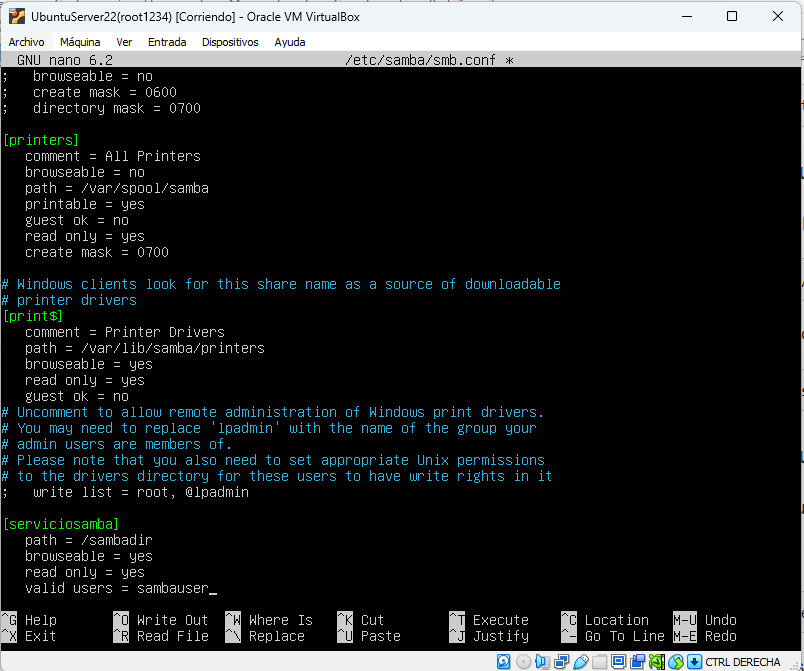

#  Configuración de un servidor SAMBA
Este documento contiene una pequeña guía para configurar un servidor Samba, que te permitirá compartir archivos con los nodos de tu red. 
## Índice 
- [1. Introducción](#1-introducción)
- [2. Requisitos previos](#2-requisitos-previos)
- [3. Procedimiento](#3-procedimiento)
  - [3.1 Instalación de SAMBA en el servidor](#31-instalación-de-samba-en-el-servidor)
  - [3.2 Creación de usuarios para SAMBA](#32-creación-de-usuarios-para-samba)
  - [3.3 Configuración de la capeta compartida](#33-configuración-de-la-capeta-compartida)
  - [3.4 Configuración del servicio](#34-configuración-del-servicio)
  - [3.5 Instalación de SAMBA en el cliente Ubuntu](#35-instalación-de-samba-en-el-cliente-ubuntu)
- [4. Comprobaciones](#4-comprobaciones)
- [5. Acceso al servicio](#5-acceso-al-servicio)
- [6. Diferentes opciones de smb.conf](#6-diferentes-opciones-de-smbconf)
  - [6.1 Opciones de acceso y visibilidad](#61-opciones-de-acceso-y-visibilidad)
  - [6.2 Control de usuarios y permisos](#62-control-de-usuarios-y-permisos)
  - [6.3 Creación de archivos y carpetas. Máscaras POSIX](#63-creación-de-archivos-y-carpetas-máscaras-posix)
- [7 Create mask y force create mode, explicación](#7-create-mask-y-force-create-mode-explicación)
  - [7.1 Como afecta create mask a los permisos](#71-como-afecta-create-mask-a-los-permisos)
  - [7.2 Como afecta force create mode a los permisos](#72-como-afecta-force-create-mode-a-los-permisos)
- [8. Referencias](#8-referencias)
- [9. Segunda Versión](#9-segunda-versión)
---
## 1. Introducción
**Samba** es un software libre del protocolo de red **SMB/CIFS** que permite compartir archivos e impresoras en red de forma transparente entre sistemas operativos **Linux/Unix** y sistemas **Windows**.

**Aspectos clave:**
- **Interoperabilidad**: Permite que un equipo o servidor con Linux funcione como un servidor de archivos en un entorno de red con ordenadores Windows, o viceversa.
- **Control de acceso y permisos**: Permite gestionar qué usuarios o grupos pueden leer, modificar o guardar archivos en las carpetas compartidas.
- **Integración**: Puede integrarse con servicios de dominio como Active Directory de Windows.
## 2. Requisitos previos 
- **Linux**. Necesitas un servidor con un S.O. basado en Linux (en nuestro caso será con Ubuntu Server).
- **Acceso root**. Tener un usuario con privilegios `sudo`.
- **Configuración de red**. El servidor deberá tener configurada la red en modo **IP estática**.
- **Espacio en disco**. El servidor deberá tener espacio suficiente o una partición dedicada para almacenar los archivos.
## 3. Procedimiento 
### 3.1 Instalación de SAMBA en el servidor 
En nuestro servidor Ubuntu tecleamos los siguientes comandos:
```bash
sudo apt update
sudo apt-get install samba
```
Y realizamos la instalación.
### 3.2 Creación de usuarios para SAMBA
Para la creación de usuarios que tenga acceso a los archivos compartidos por SAMBA debemos utilizar los siguientes comandos. 
1. Creación de usuarios en Ubuntu.	
```bash
sudo adduser sambauser
```
2. Registro de usuarios en SAMBA.
```bash
sudo smbpasswd -a sambauser
```
3. Comprobamos si el usuario esta en la base de datos de SAMBA.
```bash
sudo pdbedit -w -L
```
### 3.3 Configuración de la capeta compartida
1. Creamos la carpeta.	
```bash
sudo mkdir /sambadir
```
2. Cambiamos el owner y grupo de la carpeta.
```bash
sudo chown sambauser:sambauser /sambadir
```
### 3.4 Configuración del servicio 
Para la configuración del servicio debemos acceder al archivo de configuración `smb.conf`
1. Acceso a `smb.conf`.	
```bash
sudo nano /etc/samba/smb.conf
```
2. Añadimos las siguientes lineas al archivo.
```bash
[serviciosamba]
   path = /sambadir
   browseable = yes
   read only = no
   valid users = sambauser
```

En la imagen vemos como debe quedar `smb.conf` con esta configuración mínima 

3. Reiniciamos el servicio y comprobamos su estado	
```bash
sudo systemctl restart smbd
sudo systemctl status smbd
```
### 3.5 Instalación de SAMBA en el cliente Ubuntu
En los clientes que tengan S.O. basado en Linux debemos instalar **samba client**
```bash
sudo apt-get install smbclient
```
## 4. Comprobaciones
Comprobar smb.conf (desde el servidor)
```bash
testparm
```
Lista los recursos compartido (desde el cliente)
```bash
smbclient -L //192.168.100.254 -U sambauser
```
 Entra/conecta al recurso (desde el cliente)
 ```bash
smbclient //192.168.100.254/serviciosamba -U sambauser
```
## 5. Acceso al servicio 
Desde **Ubuntu** escribiendo en el explorador de archivos abajo derecha
```bash
smb://192.168.100.254/serviciosamba
```
Desde **Windows** escribiendo en el explorador de archivos
```bash
\\192.168.100.254\serviciosamba
```
## 6. Diferentes opciones de smb.conf 
### 6.1 Opciones de acceso y visibilidad
Definir la ruta absoluta del directorio
```bash
path = /sambadir
``` 	
Determinir si el recurso compartido es visible en la red (por defecto es yes)
```bash
browseable = yes | no
``` 
Definir si el recurso es solo de lectura
```bash
read only = yes | no
writable = yes | no
``` 
Permitir acceso a usuarios anónimos o sin autenticación (por defecto es no) 
```bash
guest ok = yes | no
public = yes | no
``` 
### 6.2 Control de usuarios y permisos
Restringir el acceso a una lista de usuarios o grupos (los grupos se anteceden con @).	
```bash
valid users = @grupo, usuario1
``` 
Definir una lista de usuarios a los que se les prohíbe el acceso, priorizándose sobre valid users.	
```bash
invalid users = usuario
``` 
Permitir otorgar permisos de escritura solo a una lista de usuarios o grupos (solo si *read only = yes*)
```bash
write list = @editores, usuario_admin
``` 
Todas las operaciones del recurso compartido se realizaran con los permisos del usuario especificado 	
```bash
force user = nombre_usuario
``` 
Todas las operaciones del recurso compartido se realizaran con los permisos del @grupo especificado
```bash
force group = nombre_grupo
``` 
### 6.3 Creación de archivos y carpetas. Máscaras POSIX
Aplicar una máscara de permisos máxima para los archivos nuevos que se creen desde la **red**.	
```bash
create mask = 0660
``` 
Asegurar que ciertos bits de permisos estén siempre presentes al crear archivos nuevos.	
```bash
force create mode = 0660
``` 
Aplicar la máscara de permisos predeterminada para los directorios o carpetas nuevas.
```bash
directory mask = 0770
``` 
Fozar bits de permisos mínimos en la creación de directorios
```bash
force directory mode = 0770
``` 
## 7 Create mask y force create mode, explicación
### 7.1 Como afecta create mask a los permisos 
>(en este caso *create mask = 0660*)

**Caso 1: Desde el cliente se crea un archivo y se definen más permisos (0777) que los definidos en *create mask* (0660):**

*Create mask* aplica una operación **lógica AND** a cada bit de cada permiso (lectura, escritura y ejecución)

|  | Propietario (rwx) | Grupo (rwx) |Otros (rwx)|
| :---- | :----: | :----: | :----: |
| **Cliente (0777)** | 111 | 111 | 111 | 
| **create mask (0660)**  | 110 | 110 | 000 |
| **(Se aplica Máscara AND) Resultado (0660)** | 110 | 110 | 000 |

**Caso 2: Desde el cliente se crea un archivo y se definen menos permisos (0440):**

Se vuelve aplicar una operación **lógica AND**.

|  | Propietario (rwx) | Grupo (rwx) |Otros (rwx)|
| :---- | :----: | :----: | :----: |
| **Cliente (0440)** | 100 | 100 | 000 | 
| **create mask (0660)**  | 110 | 110 | 000 |
| **(Se aplica Máscara AND) Resultado (0440)** | 100 | 100 | 000 |

> A la práctica *create mask* establece un tope en los permisos que podrán recibir los archivos creados desde la red.
### 7.2 Como afecta force create mode a los permisos 
>(en este caso *force create mode = 0020*)

*Force create mode* aplica una operación **lógica OR**. 

|  | Propietario (rwx) | Grupo (rwx) |Otros (rwx)|
| :---- | :----: | :----: | :----: |
| **Cliente (0440)** | 100 | 100 | 000 | 
| **create mask (0020)**  | 000 | 010 | 000 |
| **(Se aplica Máscara OR) Resultado (0460)** | 100 | 110 | 000 |

> *Force create mode* establece permisos mínimos para los archivos 
## 8. Referencias 
- [Documentación oficial de Samba ]( https://www.samba.org/samba/docs/) - Guías oficiales, manuales de configuración y sintaxis de smb.conf.
- [Página de manual de smb.conf](https://www.samba.org/samba/docs/current/man-html/smb.conf.5.html) - Manual con todas las directivas de configuración disponibles.
- [Debian Wiki - Samba Server](https://wiki.debian.org/Samba/Server) - Guía práctica paso a paso para la configuración de carpetas compartidas en sistemas Debian/Ubuntu.
## 9. Segunda Versión
Estos son los cambios para la segunda versión del documento

|  |Tabla | Tercera | Versión|
| :---- | :----: | :----: | :----: |
| abcdef | 123456 | ACBDEF | 654321 | 
| 101010 | 010101 | 111000 | 000111 |
| xxxxxxx | xxxxxxx | xxxxxxx | xxxxxxx |

## Información del proyecto
Esta documentación se ha elaborado utilizando Markdown.
El control de versiones se realiza mediante Git
y el repositorio remoto se encuentra alojado en GitHub.

## Próximas mejoras
- Mejora 1
- Mejora 2
- Mejora 3
